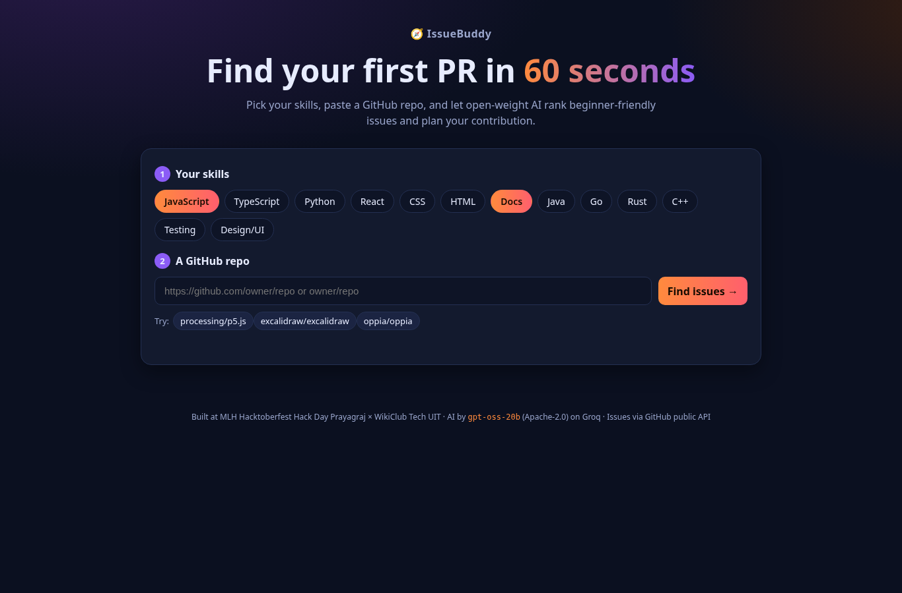
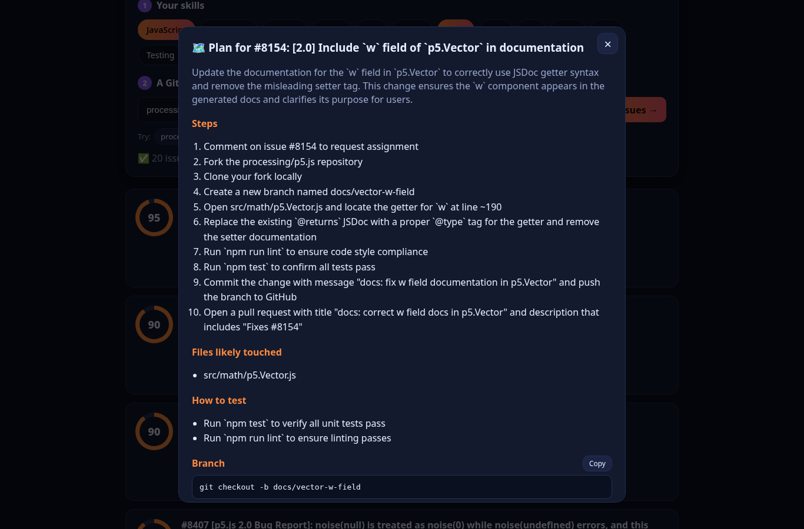
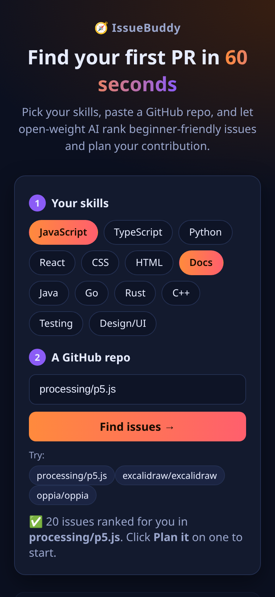

# 🧭 IssueBuddy: find your first PR in 60 seconds

Hacktoberfest is here, but beginners spend hours searching for an issue they can actually solve.
**IssueBuddy** asks for your skills and a GitHub repo, pulls its beginner-friendly issues, uses **open-weight AI** to rank them by how well they fit *you*, and then writes a step-by-step contribution plan with a ready-to-paste commit message and PR description.

Built at **MLH Hacktoberfest Hack Day Prayagraj × WikiClub Tech UIT (Edition 2.0)**.





## ✨ Features
- **Skill picker**: JavaScript, TypeScript, Python, React, CSS, HTML, Docs, Java, Go, Rust, C++, Testing, Design/UI.
- **Any public repo**: paste `owner/repo` or a GitHub URL, or try a sample repo (p5.js, Excalidraw, Oppia, all of which have open `good first issue` labels).
- **Live issues** from the GitHub public REST API, fetched in the browser, covering the labels `good first issue`, `hacktoberfest`, `help wanted` and `documentation`. Assigned issues sort to the bottom, and there's a friendly message when you hit the rate limit.
- **AI ranking** (`/api/rank`): a 0 to 100 fit score, a difficulty (Easy/Medium/Hard) and a one-line reason for each issue.
- **Plan it** (`/api/plan`): steps (ask to be assigned → fork → branch → change → test → PR), the files likely touched, how to test, a branch name, the commit message, and the PR title and body, each with a Copy button.
- Responsive dark UI, skeleton loaders, and graceful errors (if the AI is unavailable, the issues still show unranked).

## 🧠 Open-weight AI
IssueBuddy calls [Groq](https://groq.com)'s OpenAI-compatible API with **`openai/gpt-oss-20b`**, an open-weight model released under the **Apache-2.0** license. If it's rate-limited, times out or returns invalid JSON, it falls back to `gpt-oss-120b` and then `qwen`. The API key stays on the server (`GROQ_API_KEY`) and never reaches the browser.

## 🛠 Tech
Static `index.html` + `style.css` + `app.js` (no build step) · Vercel serverless functions in `api/` · Node 18+ `fetch` · GitHub REST API.

## 🚀 Run locally
```bash
git clone <this repo> && cd issuebuddy
GROQ_API_KEY=your_key node server.js   # http://localhost:3000
```
`server.js` serves the static files and the `api/*.js` functions the same way Vercel does. No dependencies are needed.

**Deploy:** import the repo on Vercel, add the env var `GROQ_API_KEY` (and optionally `GROQ_MODEL`), then deploy. The framework preset is "Other".

## 👥 Team
- **Abhi** ([@THE-AB-mark](https://github.com/THE-AB-mark)), team leader
- **Ayush Yadav** ([@ayush8620](https://github.com/ayush8620))
- **Kriti Kumari**

## 🤝 Contributing
We're a Hacktoberfest project too! See [CONTRIBUTING.md](CONTRIBUTING.md) for good first issues.

## 📄 License
[MIT](LICENSE)
